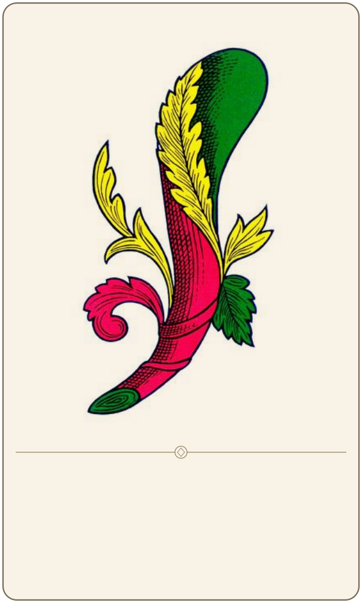
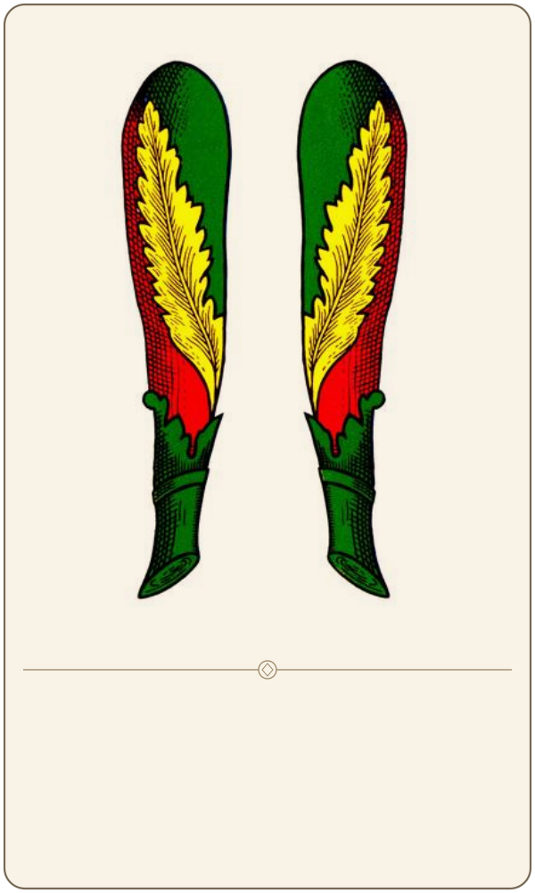
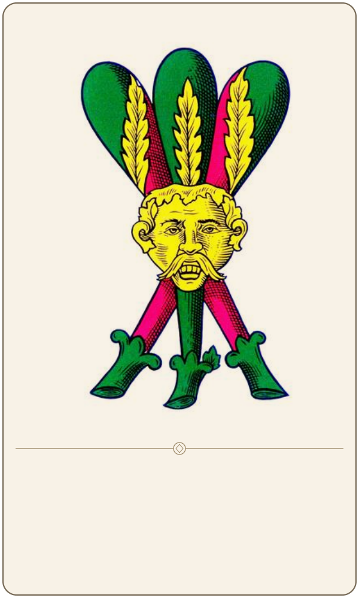
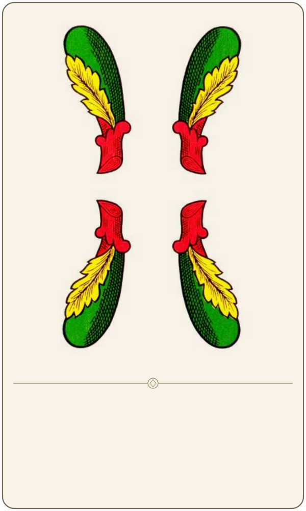
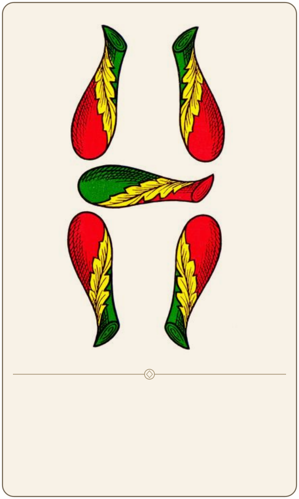
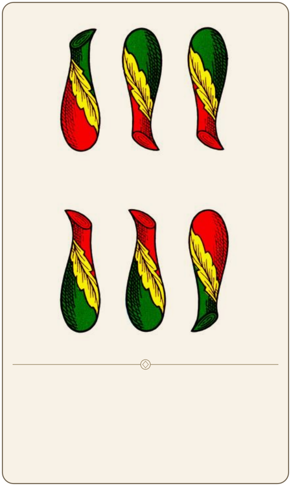
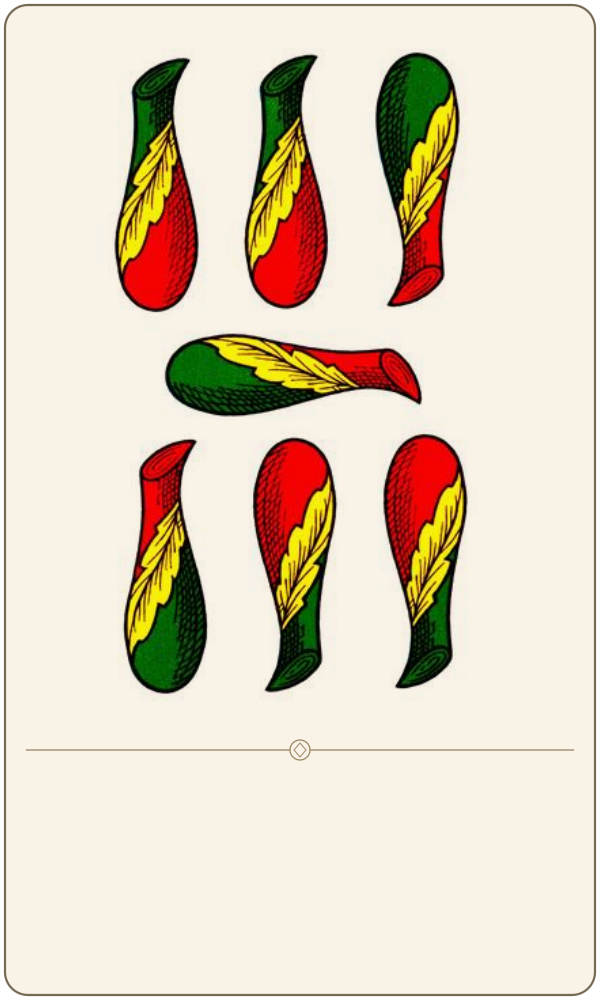
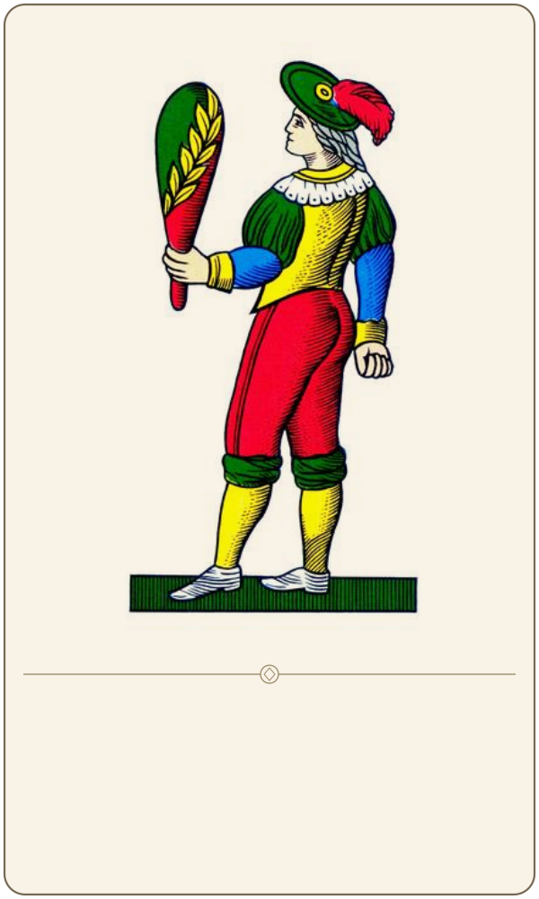
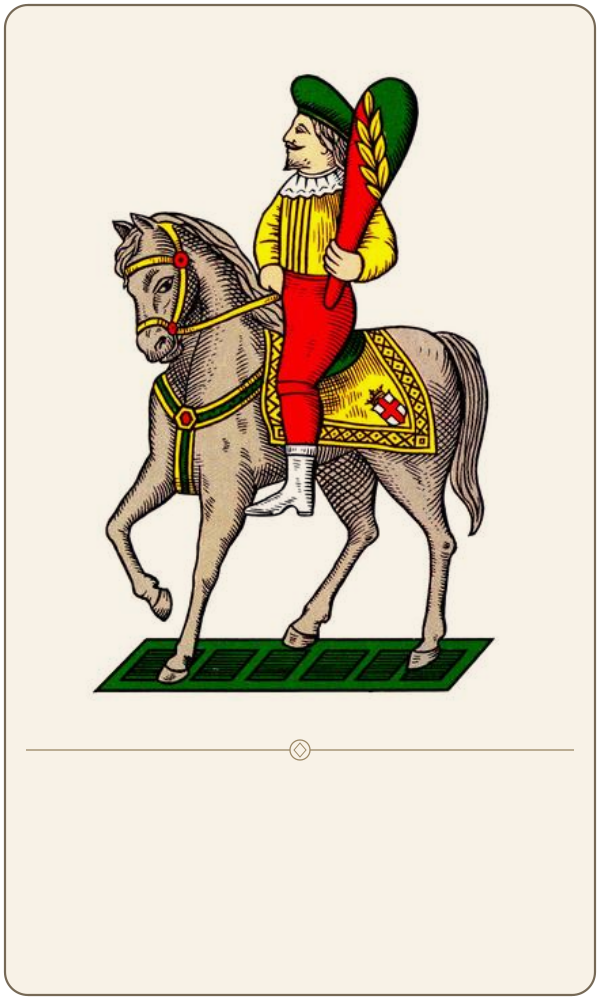
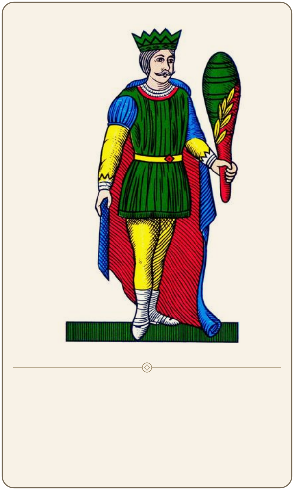

# Scopone Alchemico — Bastoni, seme tradizionale completo (B01–B10)

**Stato: proposta grafica per approvazione.** Nessun file del gioco o delle carte precedenti viene sovrascritto.

## Le 10 carte
Asso (B01), 2 (B02), 3 (B03), 4 (B04), 5 (B05), 6 (B06), 7 (B07), Fante (B08), Cavallo (B09), Re (B10).

| Asso | Due | Tre | Quattro | Cinque |
|---|---|---|---|---|
|  |  |  |  |  |

| Sei | Sette | Fante | Cavallo | Re |
|---|---|---|---|---|
|  |  |  |  |  |

## Origine iconografica e diritti
- Immagini autentiche di carte napoletane scaricate singolarmente da `OMerkel/scopa_marco/data/cards/Napoletane/{1..10}b.jpg`: https://github.com/OMerkel/scopa_marco/tree/master/data/cards/Napoletane
- Il progetto Scopa dell'autore Marco Scarpetta specifica che i JPEG **Napoletane sono di pubblico dominio**, ottenuti da Wikimedia Commons: https://github.com/OMerkel/scopa_marco
- Una fonte originaria delle singole immagini è il mazzo di `Trocche100`, ad esempio l'Asso: https://commons.wikimedia.org/wiki/File:31_Asso_di_bastoni.jpg (pubblico dominio).
- Confronto di riferimento con il foglio completo del seme: scansione di Despues (CC BY-SA 3.0): https://commons.wikimedia.org/wiki/File:Carte_da_gioco_napoletane_bastoni.jpg
- **L'Asso, il 3 con il mascherone e tutte le altre composizioni sono i disegni tradizionali**, senza rigenerazione AI, senza nuove pose o ritocchi pittorici.

## File consegnati
Per ogni identificativo `Bxx`:
1. `Bxx-[nome]-originale.jpg` — copia esatta del JPEG tradizionale, pixel e contenuto immutati.
2. `Bxx-[nome]-gioco.svg` — **carta auto-contenuta 600×1000**, con lo stesso JPEG incorporato, fondo avorio `#F8F2E7`, area inferiore 25% vuota e un piccolo sigillo alchemico sul divisorio.

Il sigillo è un **livello grafico indipendente**; nessun emblema è stato disegnato sopra i soggetti autentici.
Il rendering SVG usa una composizione moltiplica sopra l'avorio, che può variare leggermente la tinta percepita, ma non modifica il file storico. I file sorgente JPEG del repository pubblico sono raster di dimensioni inferiori ai 600 pixel; l'SVG li adatta per schermi moderni, **senza aggiungere risoluzione**.

I testi di valore, nome, abilità e ogni parametro numerico devono essere aggiunti dal livello HTML/CSS del gioco. Non sono inclusi nella grafica.

## Verifica
- 10 carte di un unico mazzo, tutte con il medesimo disegno e palette tradizionale.
- Composizioni numerali conservate; il **3 di Bastoni** presenta il **Gatto Mammone** originale.
- Fante, Cavallo, Re non sono reinterpretati.
- Immagini storiche conservate intatte e importate da una sorgente pubblica identificabile.
- Nessuna modifica al motore matematico, a `index.html` o alle figure extra del gioco.

Apri `anteprima.html` in un browser per visionare la serie completa con i nomi.

**Non integrare su `main` senza approvazione del proprietario.**
